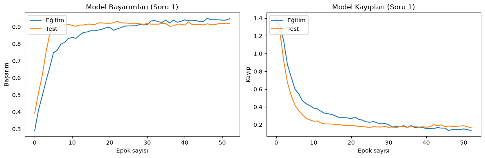
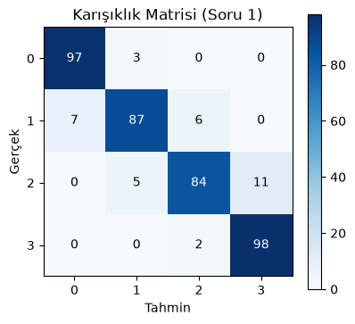
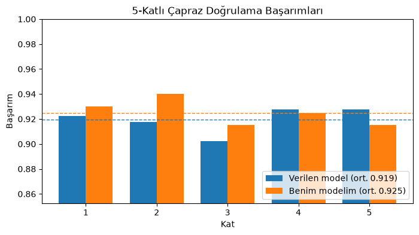
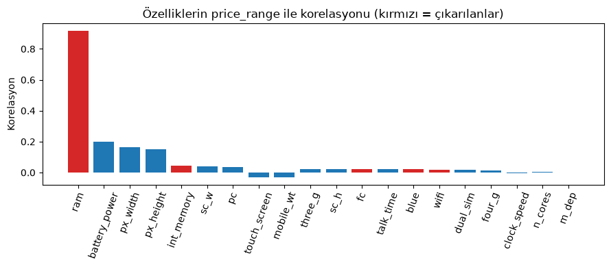
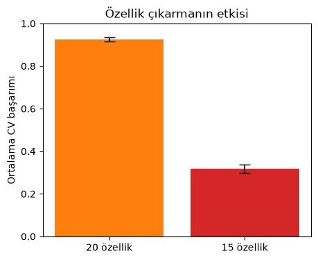
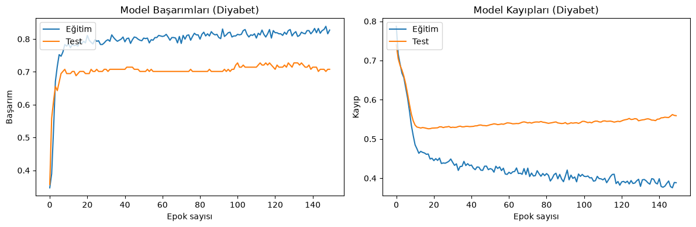
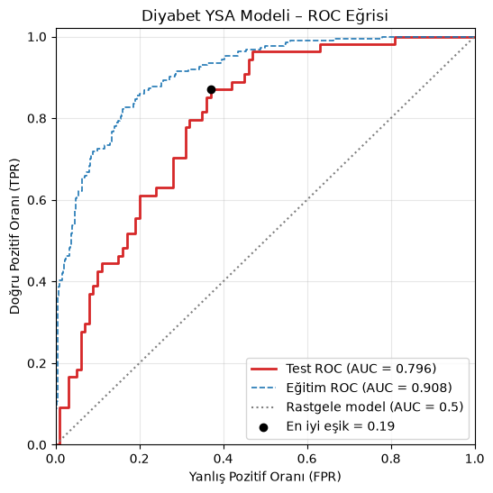

# Yapay Sinir Ağları ile Sınıflandırma: Telefon Fiyatı ve Diyabet

> Fırat Üniversitesi · YMH451 Yapay Zeka · Uygulama 4 (2. hafta)
> Python · TensorFlow/Keras · scikit-learn

Bu çalışmada iki soruya cevap aradım:

1. **Bir telefonun teknik özelliklerinden fiyat sınıfı tahmin edilebilir mi?** Hangi özellikler bu tahmin için gerçekten önemli?
2. **Basit klinik ölçümlerden bir kişinin diyabet olup olmadığı tahmin edilebilir mi?** Bu tahmin ne kadar güvenilir?

İki soru için de yapay sinir ağı (YSA) kurdum. Modelleri tek bir test skoruyla bırakmadım: çapraz doğrulama, özellik çıkarma ve ROC eğrisiyle de değerlendirdim.

---

## Kısaca sonuçlar

| | Amaç | Sonuç |
|---|---|---|
| **Soru 1** | Kendi YSA modelimi kurmak | Hiç görmediği 400 telefonun **%91.5**'ini doğru sınıflandırdı |
| **Soru 2** | Bu başarının şans olmadığını göstermek | 5-katlı çapraz doğrulamada **%92.5 ± 0.95** |
| **Soru 3** | 5 özellik çıkarılınca ne olacağını görmek | Başarım **%92.5'ten %31.8'e** düştü. Sebebi tek bir özellik: `ram` |
| **Soru 4** | Diyabet tahmini için YSA kurmak | Test başarımı **%70.8**; grafikte ezberleme (overfitting) görüldü |
| **Soru 5** | Diyabet modelinin ayırt etme gücünü ölçmek | **AUC = 0.80**. Karar eşiği ayarlanınca kaçırılan hasta sayısı 26'dan 7'ye indi |

---

## Veri setleri

| Veri | Satır | Özellik | Hedef |
|---|---|---|---|
| [Mobile Price Classification](https://www.kaggle.com/datasets/iabhishekofficial/mobile-price-classification) | 2000 | 20 (RAM, batarya, ekran çözünürlüğü, kamera…) | `price_range`: 0 (ucuz) – 3 (çok pahalı), her sınıftan 500 |
| [Pima Indians Diabetes](https://www.kaggle.com/datasets/uciml/pima-indians-diabetes-database) | 768 | 8 (kan şekeri, BMI, yaş, insülin…) | `Outcome`: 0 sağlıklı (500), 1 diyabet (268) |

---

## Soru 1: Kendi modelimi kurmak

**Amaç:** Hocanın verdiği örnek modeli (16 → 12 → 4 nöron) inceleyip kendi modelimi tasarlamak.

**Ne yaptım:**
- Ağı büyüttüm: **64 → 32 → 16 → 4** nöron, gizli katmanlarda ReLU, çıkışta softmax.
- Ezberlemeyi azaltmak için **Dropout** (her adımda nöronların %20–30'unu rastgele kapatır) ekledim.
- Sabit 150 epok yerine **EarlyStopping** kullandım: doğrulama kaybı 20 epok boyunca iyileşmezse eğitim duruyor.
- Örnek kodda fark ettiğim bir hatayı düzelttim. Ölçekleme (`StandardScaler`) tüm veriye uygulanıyor, eğitim/test ayrımı ondan **sonra** yapılıyordu. Bu, test verisinin bilgisinin eğitime sızması demek. Ben önce veriyi ayırdım, ölçeklemeyi sadece eğitim verisinden öğrendim.

**Ne oldu:** Eğitim 53. epokta kendiliğinden durdu ve test başarımı **%91.5** çıktı. Karışıklık matrisinde 34 hatanın **hepsi komşu sınıflar** arasında (ör. orta ↔ pahalı). Model hiçbir telefonu iki sınıf öteye atmadı; ucuza "pahalı" ya da "çok pahalı" demedi. Fiyat sınıfları sıralı olduğu için bu beklenen bir durum.

<p align="center">
  
  
</p>

---

## Soru 2: Bu başarı şans mı?

**Amaç:** Tek bir eğitim/test bölmesinde test kısmı şans eseri kolay gelmiş olabilir. Modelin gerçek başarısını daha güvenilir şekilde ölçmek istedim.

**Ne yaptım:** **5-katlı çapraz doğrulama** uyguladım. Veri 5 parçaya bölünüyor; model her turda 4 parçayla eğitilip kalan 1 parçayla test ediliyor. Böylece her örnek bir kez test verisi oluyor. Her turda modeli sıfırdan kurdum ve ölçeklemeyi o turun eğitim verisinden yaptım. Karşılaştırma için aynı işlemi hocanın modeline de uyguladım.

**Ne oldu:**

| Model | Kat 1 | Kat 2 | Kat 3 | Kat 4 | Kat 5 | **Ortalama** |
|---|---|---|---|---|---|---|
| Verilen (16-12-4) | 92.25 | 91.75 | 90.25 | 92.75 | 92.75 | **91.95 ± 0.93** |
| Benim (64-32-16-4) | 93.00 | 94.00 | 91.50 | 92.50 | 91.50 | **92.50 ± 0.95** |

- Standart sapma %1'in altında, yani başarı veri bölünmesine göre çok değişmiyor ve model **kararlı**.
- Benim modelim ortalamada ~0.5 puan önde. Fark küçük ve sapma aralığı içinde. Bu yüzden asıl kazanç başarımda değil: EarlyStopping sayesinde aynı sonuca çok daha az epokla ulaşılıyor.

<p align="center"></p>

---

## Soru 3: Özellikleri çıkarınca ne olur?

**Amaç:** `blue`, `fc`, `int_memory`, `ram` ve `wifi` çıkarıldığında modelin nasıl etkilendiğini görmek.

**Ne yaptım:** Aynı modeli ve aynı 5-katlı çapraz doğrulamayı 20 yerine **15 özellikle** tekrarladım. Düşüşün sebebini bulmak için her özelliğin fiyatla korelasyonunu çizdim.

**Ne oldu:** Başarım **%92.5'ten %31.8'e** düştü. 4 sınıflı bir problemde rastgele tahmin %25 eder, yani model neredeyse hiçbir şey öğrenemedi.

Korelasyon grafiği sebebi açıkça gösteriyor. Çıkarılan 5 özellikten **`ram`'in fiyatla korelasyonu 0.92**, diğer dördününki ise 0.05'in altında. Kalan 15 özelliğin en güçlüsü bile (batarya) 0.20'de kalıyor. Kısacası bu veri setinde fiyatı neredeyse tek başına RAM belirliyor.

<p align="center">
  
  
</p>

> **Çıkarım:** Özellik seçimi gelişigüzel yapılmamalı. Tek bir baskın özelliği kaybetmek, ne kadar iyi bir model kurulursa kurulsun, sonucu tamamen değiştirebilir.

---

## Soru 4: Diyabet tahmini

**Amaç:** Diyabet verisiyle bir YSA kurmak, eğitim ve doğrulama başarım/kayıplarını grafikte göstermek.

**Ne yaptım:**
- **Veri temizliği:** Kan şekeri, tansiyon, BMI gibi sütunlarda `0` değerleri vardı. Bunlar biyolojik olarak imkânsız, yani aslında eksik ölçüm (ör. insülinde 374 kişi). Bu boşlukları eğitim verisinin medyanıyla doldurdum.
- **Model:** 8 → 16 → 8 → 1 nöron. Problem iki sınıflı olduğu için çıkışta **sigmoid**, kayıp olarak `binary_crossentropy` kullandım.
- 150 epok eğittim ve her epokta eğitim ile doğrulama değerlerini kaydettim.

**Ne oldu:** Grafikte **aşırı öğrenme (overfitting)** açıkça görülüyor. Eğitim kaybı sürekli düşüyor. Doğrulama kaybı ise **18. epokta en düşük** değerine iniyor, sonra yükselmeye başlıyor. Model eğitim verisini ezberliyor (%83) ama yeni hastalarda %71'de kalıyor.

Test başarımı %70.8. Veri dengesiz olduğu için model sağlıklı kişileri iyi tanıyor (duyarlılık 0.81), diyabetlileri ise zayıf tanıyor (0.52): **54 diyabetli hastanın 26'sını kaçırıyor.**

<p align="center"></p>

---

## Soru 5: ROC eğrisi

**Amaç:** Modelin hastayı sağlamdan ne kadar iyi ayırt ettiğini, tek bir eşiğe bağlı kalmadan ölçmek.

**Ne yaptım:** Model her kişi için 0 ile 1 arasında bir **diyabet olasılığı** veriyor. Karar eşiğini 1'den 0'a kaydırdım ve her eşikte iki oranı hesapladım: doğru yakalanan hastaların oranı (TPR) ve yanlışlıkla "hasta" denen sağlıklıların oranı (FPR). Bu noktaları birleştirince ROC eğrisi çıkıyor. En iyi eşiği **Youden J** yöntemiyle buldum (TPR − FPR'nin en büyük olduğu nokta).

**Ne oldu:**
- **Test AUC = 0.796.** Rastgele seçilen bir diyabetli hastaya, rastgele seçilen sağlıklı birinden daha yüksek risk verme olasılığı yaklaşık %80. Rastgele tahmin 0.5, mükemmel model 1.0.
- Eğitim AUC'u (0.908) ile test AUC'u arasındaki fark, Soru 4'teki aşırı öğrenmeyi doğruluyor.
- Varsayılan 0.5 eşiği bu problem için uygun değil. **Eşik 0.19'a indirilince:**

| Eşik | Kaçırılan hasta | Yanlış alarm | Duyarlılık | Başarım |
|---|---|---|---|---|
| 0.50 | 26 / 54 | 19 | 0.52 | %70.8 |
| **0.19** | **7 / 54** | 37 | **0.87** | %71.4 |

Tarama testinde bir hastayı kaçırmak, bir sağlıklıyı ileri teste göndermekten çok daha maliyetli. Bu yüzden düşük eşik daha doğru bir tercih.

<p align="center"></p>

---

## Neler öğrendim

- **Tek bir test skoru yanıltabilir.** Çapraz doğrulama, sonucun şanstan mı yoksa gerçek öğrenmeden mi geldiğini gösteriyor.
- **Veri sızıntısı sessiz bir hatadır.** Ölçeklemeyi veriyi ayırmadan önce yapmak hata vermiyor ama sonucu olduğundan iyi gösteriyor.
- **Model kadar veri de önemli.** Telefon verisinde tek bir özellik (RAM) başarının neredeyse tamamını taşıyor.
- **Eğitim/doğrulama grafikleri ezberlemeyi gösterir.** Doğrulama kaybı yükselmeye başladığında eğitimi durdurmak gerekir.
- **Başarım (accuracy) her zaman doğru ölçü değil.** Dengesiz ve tıbbi bir problemde ROC/AUC ve doğru seçilmiş bir eşik çok daha anlamlı.

---

## Dosyalar

| Dosya | İçerik |
|---|---|
| `Uygulama4_YSA_SenaKose.ipynb` | Tüm kod, çıktılar ve grafikler. Her sorunun başında basit bir açıklama, kodda satır satır yorumlar var |
| `Uygulama4_YSA_SenaKose.py` | Aynı çalışma, açıklamaları yorum satırı olarak içeren tek bir Python dosyası |
| `telefon_fiyat_degisimi.csv`, `diyabet.csv` | Veri setleri |
| `gorseller/` | README'deki grafikler |

## Çalıştırma

```bash
python3.12 -m venv .venv && source .venv/bin/activate
pip install -r requirements.txt
jupyter lab Uygulama4_YSA_SenaKose.ipynb    # ya da: python Uygulama4_YSA_SenaKose.py
```

Sonuçların tekrarlanabilmesi için rastgelelik tohumu sabitlendi (`SEED = 42`). Tüm notebook'un çalışması normal bir dizüstü bilgisayarda 5–10 dakika sürüyor.

---

**Sena Köse** · Fırat Üniversitesi Yazılım Mühendisliği
